# A股与港股板块研究：传导框架与龙头观察

更新：2026-11-11；窗口：2026-11-11 至 2027-05-11。

先观察龙头与细分标杆的经营动向，再在板块内独立筛选合适个股。观察名单不等于候选买入名单，最终可以选择龙头，也可以选择其他公司。

本轮结合公开报告的2026H1、Q2、Q3及既有研究，逐项标日期；没有把所有公司统一更新为最新季报，没有新抓实时股价或计算整板块估值。

## A股

### 煤炭开采 · 主要方向

保留现金分红主线；支持点是煤炭经营现金流，而不是赌煤价持续上涨。

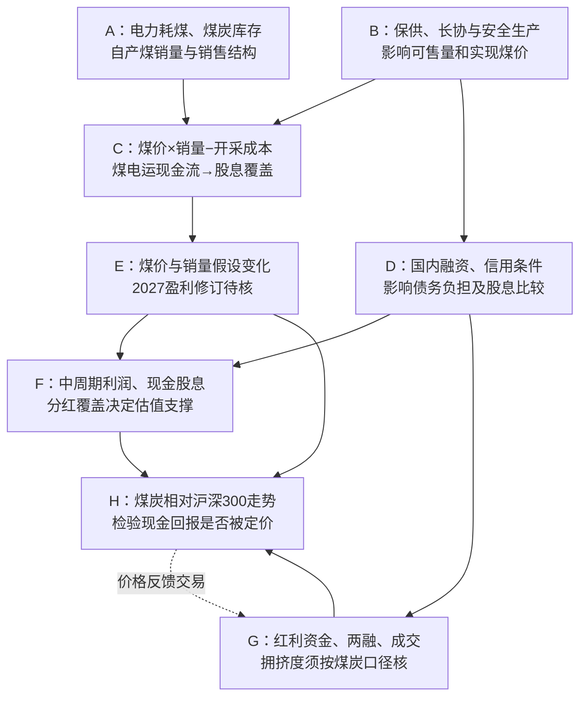

- **A**：电力需求、发电结构与动力煤库存共同决定销量；冬季旺季不等于全年高价。
- **B**：保供和长协约束价格弹性，稳定供给不保证利润或分红。
- **C**：实现均价×销量−单位成本决定煤炭利润；煤电运合并结构和收购影响同比可比性。
- **D**：引用A股D：国内融资条件支持只是背景；看企业实际利息、信用与营运资金，不能把国债减PPI当真实借款成本。
- **E**：固定目标年度2027，比较可比机构样本的30/90日EPS修订。本轮未取得板块完整序列；实际收入、利润增长只记C，不冒充E。
- **F**：优先看可持续现金股息、资本开支后现金余额及周期中枢利润；不以低PE单独定便宜。
- **G**：A股两融/流通市值、ETF份额与成交占比分开观察；当前细分映射不等同旧宽行业，未新计算统一拥挤度。
- **H**：与沪深300同窗比较20/60日表现；本轮未构造这组映射股票的合成指数，不能把几家公司均涨写成行业趋势。

**证据与反证**

- 2026H1：陕西煤业煤炭产量同比+4.32%，销量同比−2.44%；生产增长并不等于销售增长。 [来源](https://static.cninfo.com.cn/finalpage/2026-08-28/1225516359.PDF)
- 2026H1：中国神华报告披露收购及新增煤电资产，分析同比须检查并表范围变化。 [来源](https://static.cninfo.com.cn/finalpage/2026-08-29/1225531759.PDF)

**龙头与细分标杆观察**

| 公司 | 观察身份及理由 | 跟踪动向 |
|---|---|---|
| 中国神华 601088 | 煤电运一体化龙头：用一体化经营观察煤价波动能否转化为稳定现金与分红。 | A/C/F：同口径自产煤销量、成本、资本开支与分红覆盖 |
| 陕西煤业 601225 | 煤炭开采龙头：用煤炭生产和销售观察量、价、成本的直接变化。 | A/C：销售均价、长协比例、单位成本和现金流 |

保持/升级：连续两期经营数据稳定，现金流覆盖资本开支和分红，维持主线。

降级/失效：实现售价和销量共同下降或分红需持续举债支撑，则降级。

跟踪：每月：自产/外购销量、售价、港口库存；财报：经营现金流、资本开支、分红及并表口径。

### 航运港口（偏油运） · 主要方向

保留油运盈利弹性方向；集运和港口不自动纳入，关键是有货可运且船舶可营运。

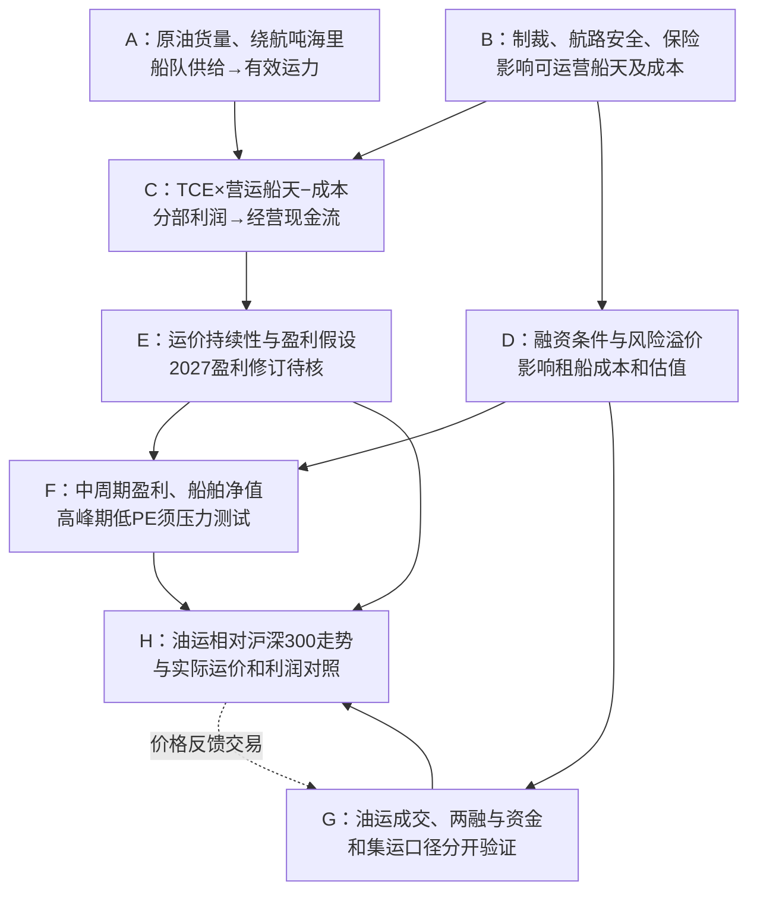

- **A**：原油贸易、绕航和转运改变吨海里与有效运力；封锁也可能减少货量。
- **B**：制裁、保险、航路安全和合规决定船舶可运营性，不能只看冲突标题。
- **C**：航线TCE×有效营运船天，扣除租赁、燃料和保险；运价向报表确认存在航次时滞。
- **D**：引用A股D：国内融资条件支持只是背景；看企业实际利息、信用与营运资金，不能把国债减PPI当真实借款成本。
- **E**：固定目标年度2027，比较可比机构样本的30/90日EPS修订。本轮未取得板块完整序列；实际收入、利润增长只记C，不冒充E。
- **F**：用周期中枢盈利、船舶净值和现金回报交叉看；不把高峰利润对应的低PE当长期估值。
- **G**：A股两融/流通市值、ETF份额与成交占比分开观察；当前细分映射不等同旧宽行业，未新计算统一拥挤度。
- **H**：与沪深300同窗比较20/60日表现；本轮未构造这组映射股票的合成指数，不能把几家公司均涨写成行业趋势。

**证据与反证**

- 2026H1：招商轮船船队结构表列有油轮60艘；公司还经营其他船型，集团利润不能全归于油运。 [来源](https://static.cninfo.com.cn/finalpage/2026-08-31/1225535203.PDF)
- 2026H1：中远海能披露海峡受阻与原油贸易收缩风险，支持区分运价上涨和可实现利润。 [来源](https://static.cninfo.com.cn/finalpage/2026-08-29/1225525952.PDF)
- 2026-11-10：EIA仍描述运输及供给约束，但也假设后续产量恢复。 [来源](https://www.eia.gov/outlooks/steo/report/)

**龙头与细分标杆观察**

| 公司 | 观察身份及理由 | 跟踪动向 |
|---|---|---|
| 中远海能 600026 | 油轮运输龙头：油轮业务直接连接吨海里、有效运力、运价和分部盈利。 | A/B/C：航线TCE、可运营船天、运输量与保险成本 |
| 招商轮船 601872 | 综合航运龙头 · 油运分部：与油运龙头交叉观察航线收益；集团其他船型需要单独拆分。 | A/C：油轮分部利润与其他船队贡献分开 |

保持/升级：货量恢复、有效运力仍紧，且公司实际TCE改善时维持。

降级/失效：连续4周同航线运价走弱并伴随实际营运收益下降；航路长期无法运行也降级。

跟踪：每周同航线TCE/运价；每月有效船天及货量；季报核油轮分部利润。

### 半导体 · 条件看好

条件看好服务器相关互连与先进封测；两条业务驱动分开，不能用AI需求概括全部半导体。

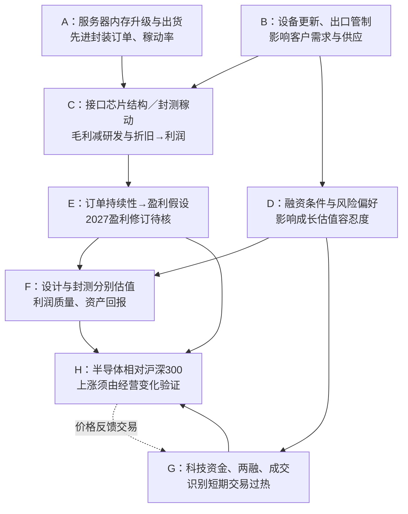

- **A**：服务器内存升级影响接口芯片，客户芯片设计和出货影响封测；终端需求链不同。
- **B**：技改与算力支持可带来需求，但出口管制须核最终规则、产品及客户范围。
- **C**：接口芯片看出货结构与研发；封测看稼动率、先进产能占比和折旧。
- **D**：引用A股D：国内融资条件支持只是背景；看企业实际利息、信用与营运资金，不能把国债减PPI当真实借款成本。
- **E**：固定目标年度2027，比较可比机构样本的30/90日EPS修订。本轮未取得板块完整序列；实际收入、利润增长只记C，不冒充E。
- **F**：设计公司看可持续利润及研发效率；封测同时看资产回报、折旧周期，不共用一个PE标准。
- **G**：A股两融/流通市值、ETF份额与成交占比分开观察；当前细分映射不等同旧宽行业，未新计算统一拥挤度。
- **H**：与沪深300同窗比较20/60日表现；本轮未构造这组映射股票的合成指数，不能把几家公司均涨写成行业趋势。

**证据与反证**

- 2026H1：澜起科技报告区分互连芯片业务，并提示主要DRAM客户集中风险。 [来源](https://static.cninfo.com.cn/finalpage/2026-08-29/1225530486.PDF)
- 2026H1：长电科技营收同比+4.96%、归母净利润+79.41%；利润增速显著高于收入，不能全部解释成新增订单。 [来源](https://static.cninfo.com.cn/finalpage/2026-08-21/1225487900.PDF)

**龙头与细分标杆观察**

| 公司 | 观察身份及理由 | 跟踪动向 |
|---|---|---|
| 澜起科技 688008 | 内存接口芯片龙头：观察内存代际升级、配套芯片结构与大客户需求。 | A/C/E：DDR5产品结构、客户集中度及毛利率 |
| 长电科技 600584 | 封装测试龙头：观察先进封装需求、产能利用率与扩产折旧的兑现。 | A/C/F：先进封装收入、稼动率、资本开支回报 |

保持/升级：连续两期出货或收入与毛利同步改善，新增资本开支可转化为现金回报。

降级/失效：订单和毛利持续走弱，或扩产折旧快于收入贡献。

跟踪：季度核DDR5代际结构、先进封装产能利用率、毛利与回款。

### 计算机设备 · 条件看好

条件看好算力基础设施，优先验证从订单到毛利和回款的转化；收入规模本身不够。

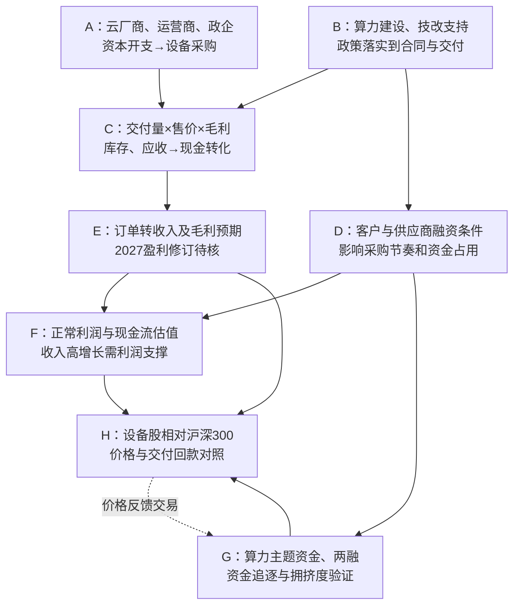

- **A**：运营商、互联网客户与政企采购是不同需求来源；把客户资本开支落实到可交付项目。
- **B**：六张网和技改支持提供融资背景，不等于合同已签或全部采用某一供应商。
- **C**：服务器/网络设备量×售价×毛利，减库存跌价、应收减值和融资成本。
- **D**：引用A股D：国内融资条件支持只是背景；看企业实际利息、信用与营运资金，不能把国债减PPI当真实借款成本。
- **E**：固定目标年度2027，比较可比机构样本的30/90日EPS修订。本轮未取得板块完整序列；实际收入、利润增长只记C，不冒充E。
- **F**：按正常毛利与可回收现金流估值；低净利率行业收入增长不能直接套高成长倍数。
- **G**：A股两融/流通市值、ETF份额与成交占比分开观察；当前细分映射不等同旧宽行业，未新计算统一拥挤度。
- **H**：与沪深300同窗比较20/60日表现；本轮未构造这组映射股票的合成指数，不能把几家公司均涨写成行业趋势。

**证据与反证**

- 2026H1：浪潮信息半年报用于核服务器业务、供应链和财务结构。 [来源](https://static.cninfo.com.cn/finalpage/2026-08-29/1225530925.PDF)
- 2026H1：紫光股份披露政务云、智算专区、金融等项目，具体交付与回款仍须跟踪。 [来源](https://static.cninfo.com.cn/finalpage/2026-08-29/1225524307.PDF)

**龙头与细分标杆观察**

| 公司 | 观察身份及理由 | 跟踪动向 |
|---|---|---|
| 浪潮信息 000977 | 服务器龙头：观察云和AI采购如何转成服务器交付、毛利与现金回款。 | A/C：订单转收入、毛利、应收和库存周转 |
| 紫光股份 000938 | 网络设备与ICT标杆：从网络设备、服务器及项目业务交叉观察客户投资节奏。 | A/B/C：业务结构、项目交付和回款 |

保持/升级：订单转收入且经营现金流改善，库存和应收不持续快于收入增长。

降级/失效：收入增长但毛利、回款持续恶化，或客户推迟验收/削减采购。

跟踪：季度核合同、交付、应收与库存周转、毛利；对大客户资本开支变化逐项映射。

### 化学制药（创新药） · 条件看好

条件看好创新药商业化与许可兑现；剔除把全化学制药或一次性授权款都当持续增长的推导。

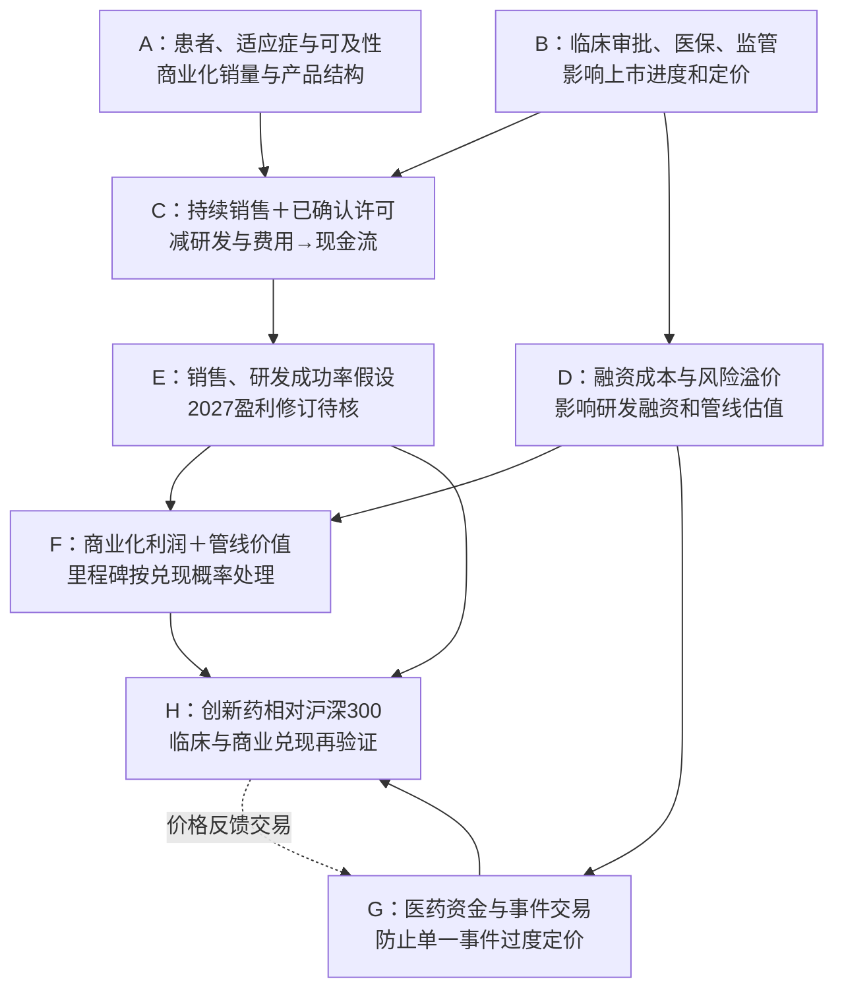

- **A**：需求来自患者覆盖、适应症和医保可及性；临床成功与实际销售间有时滞。
- **B**：审批、医保谈判与海外监管影响可及市场和价格；按具体品种核实。
- **C**：持续药品销售、首付款、里程碑和销售分成分列；扣非、研发费用与归母归属一起看。
- **D**：引用A股D：国内融资条件支持只是背景；看企业实际利息、信用与营运资金，不能把国债减PPI当真实借款成本。
- **E**：固定目标年度2027，比较可比机构样本的30/90日EPS修订。本轮未取得板块完整序列；实际收入、利润增长只记C，不冒充E。
- **F**：已有商业化利润与研发管线分开评价；风险调整估值不能用未落地里程碑总额。
- **G**：A股两融/流通市值、ETF份额与成交占比分开观察；当前细分映射不等同旧宽行业，未新计算统一拥挤度。
- **H**：与沪深300同窗比较20/60日表现；本轮未构造这组映射股票的合成指数，不能把几家公司均涨写成行业趋势。

**证据与反证**

- 2026Q3：恒瑞三季报披露新药/适应症进展和对外许可，证明事件存在，不证明未来全部收入已经实现。 [来源](https://money.finance.sina.com.cn/corp/view/vCB_AllBulletinDetail.php?id=12665396&stockid=600276)
- 2026H1：科伦归母净利同比+12.71%，扣非净利−29.03%；这是不能只看表面利润增长的反向证据。 [来源](https://static.cninfo.com.cn/finalpage/2026-08-27/1225512871.PDF)

**龙头与细分标杆观察**

| 公司 | 观察身份及理由 | 跟踪动向 |
|---|---|---|
| 恒瑞医药 600276 | 创新药龙头：观察商业化销售、临床进展、对外许可和研发投入。 | B/C/E：创新药销售、许可收入与一次性款项分开 |
| 科伦药业 002422 | 制药龙头 · 创新药业务标杆：跟踪创新药许可和商业化，同时拆分成熟业务及归母权益。 | B/C：归母与扣非差异、创新药收入实际归属 |

保持/升级：持续商业化销售改善且许可现金实际兑现，研发投入保持可支撑。

降级/失效：关键试验失败、销售低于成本预期，或利润增长依赖一次性收益而经常利润走弱。

跟踪：批准/临床里程碑发生时复核；每季核创新药销售、经常利润和现金到账。

### 化学原料 · 条件看好

条件看好具有成本优势且产品价差改善的路线；轻烃与煤化工分开，PPI上涨不是共同买入理由。

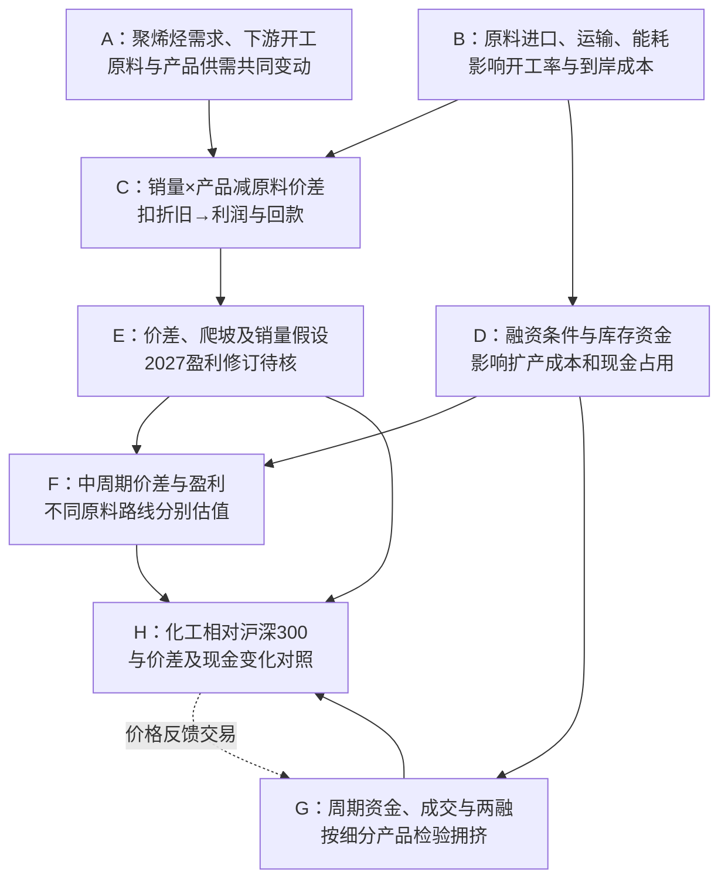

- **A**：聚烯烃及下游制造需求与原料供给共同驱动价差；油价上行可能帮产品售价也可能挤压成本。
- **B**：原料进口及运输限制、能耗环保政策改变开工与成本。
- **C**：卫星看轻烃到岸成本和产品价差；宝丰看煤制烯烃单位成本与新产能爬坡。
- **D**：引用A股D：国内融资条件支持只是背景；看企业实际利息、信用与营运资金，不能把国债减PPI当真实借款成本。
- **E**：固定目标年度2027，比较可比机构样本的30/90日EPS修订。本轮未取得板块完整序列；实际收入、利润增长只记C，不冒充E。
- **F**：以中周期价差和折旧后的盈利估值，压力测试产品售价下跌及原料上涨。
- **G**：A股两融/流通市值、ETF份额与成交占比分开观察；当前细分映射不等同旧宽行业，未新计算统一拥挤度。
- **H**：与沪深300同窗比较20/60日表现；本轮未构造这组映射股票的合成指数，不能把几家公司均涨写成行业趋势。

**证据与反证**

- 2026H1：卫星化学营收同比+30.92%、归母净利+126.94%，经营现金流同比+90.59%。 [来源](https://static.cninfo.com.cn/finalpage/2026-08-15/1225474290.PDF)
- 2026H1：宝丰能源营收同比+32.33%、归母净利+70.14%；两家样本改善不代表整个化工行业。 [来源](https://static.cninfo.com.cn/finalpage/2026-08-13/1225470229.PDF)

**龙头与细分标杆观察**

| 公司 | 观察身份及理由 | 跟踪动向 |
|---|---|---|
| 卫星化学 002648 | 轻烃化工细分龙头：观察轻烃到岸成本、产品价差与新增产能现金回报。 | A/C/F：乙烷等原料到岸成本与下游产品价差 |
| 宝丰能源 600989 | 煤制烯烃细分龙头：与轻烃路线对照，观察煤化工成本优势及产能爬坡。 | A/C/F：煤价、聚烯烃价差、新项目爬坡与负债 |

保持/升级：价差连续两月扩大，同时销量、经营现金流改善。

降级/失效：价差持续收窄或扩产只能增加库存及债务，则不升级。

跟踪：每周同口径原料/产品价差；每月开工与库存；季度现金回款和资本开支。

### 工业金属（偏铜） · 条件看好

保留铜资源的结构需求逻辑，但等待实际需求与产量兑现；矿山与冶炼利润不能混为一谈。

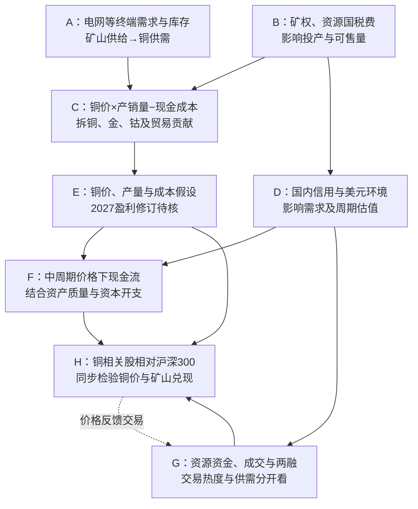

- **A**：电网等建设是需求线索；10月有色冶炼产需偏弱是反证，须结合库存和终端订单。
- **B**：矿权、资源国税费和出口政策影响可售量；国内投资支持不能抵消海外经营约束。
- **C**：矿产铜产销量×实现价−现金成本；另拆黄金、钴、锂和贸易业务。
- **D**：引用A股D：国内融资条件支持只是背景；看企业实际利息、信用与营运资金，不能把国债减PPI当真实借款成本。
- **E**：固定目标年度2027，比较可比机构样本的30/90日EPS修订。本轮未取得板块完整序列；实际收入、利润增长只记C，不冒充E。
- **F**：用中周期铜价下利润/现金流、资产质量和资本开支比较；低PE可能处于盈利高位。
- **G**：A股两融/流通市值、ETF份额与成交占比分开观察；当前细分映射不等同旧宽行业，未新计算统一拥挤度。
- **H**：与沪深300同窗比较20/60日表现；本轮未构造这组映射股票的合成指数，不能把几家公司均涨写成行业趋势。

**证据与反证**

- 2026H1：紫金披露矿产铜53.4万吨，并说明部分项目扰动，铜价上涨不能替代产量核验。 [来源](https://static.cninfo.com.cn/finalpage/2026-08-22/1225493321.PDF)
- 2026H1：洛阳钼业归母利润同比+86.27%，经营现金流+36.02%，仍需拆铜钴及贸易贡献。 [来源](https://static.cninfo.com.cn/finalpage/2026-08-20/1225482739.PDF)

**龙头与细分标杆观察**

| 公司 | 观察身份及理由 | 跟踪动向 |
|---|---|---|
| 紫金矿业 601899 | 全球化矿业龙头 · 铜业务：观察矿产铜产量、项目扰动与扩产成本；金等业务另拆。 | A/B/C：矿产铜量、矿山成本、资本开支及其他金属贡献 |
| 洛阳钼业 603993 | 铜钴资源龙头：观察铜钴产量、资源国政策与经营现金；贸易业务另拆。 | A/B/C：矿产铜量、钴政策、单位成本与贸易利润 |

保持/升级：终端订单、库存去化和矿山产量同步改善，且扩产不侵蚀现金流。

降级/失效：铜价与销量共同走弱、重大矿山停产或资本开支持续超支。

跟踪：月度看铜库存与价格；季度核矿山实际产量、成本及扩建进度。

### 电网设备 · 条件看好

政策传导最清楚的条件方向之一，但项目交付与回款是当前关键；不把电网投资等同设备商利润。

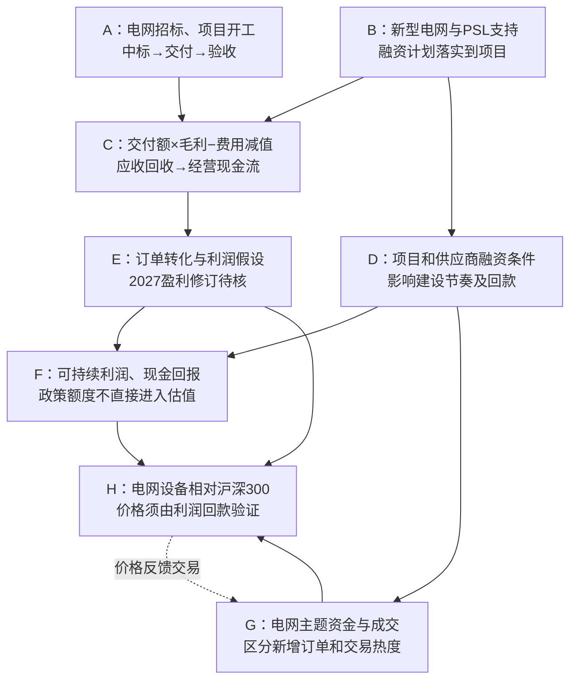

- **A**：电网投资计划需拆到招标、交付和验收；自动化、保护与直流输电的项目节奏不同。
- **B**：PSL支持六张网，新型电网在范围内；额度增加是融资条件而非订单金额。
- **C**：订单×交付率×产品毛利，减应收减值和费用；项目收入与现金回款可能跨期。
- **D**：引用A股D：国内融资条件支持只是背景；看企业实际利息、信用与营运资金，不能把国债减PPI当真实借款成本。
- **E**：固定目标年度2027，比较可比机构样本的30/90日EPS修订。本轮未取得板块完整序列；实际收入、利润增长只记C，不冒充E。
- **F**：可持续订单增长与现金转化配对估值；未形成订单的政策资金不进入收入预测。
- **G**：A股两融/流通市值、ETF份额与成交占比分开观察；当前细分映射不等同旧宽行业，未新计算统一拥挤度。
- **H**：与沪深300同窗比较20/60日表现；本轮未构造这组映射股票的合成指数，不能把几家公司均涨写成行业趋势。

**证据与反证**

- 2026H1：许继营收同比+1.21%、归母利润−34.40%、经营现金流为−3.11亿元，提示盈利与现金仍需验证。 [来源](https://static.cninfo.com.cn/finalpage/2026-08-20/1225483623.PDF)
- 2026Q3：国电南瑞三季报是核收入、利润及减值的当前资料；政策受益并非利润已经全面兑现。 [来源](https://static.cninfo.com.cn/finalpage/2026-10-29/1225635689.PDF)

**龙头与细分标杆观察**

| 公司 | 观察身份及理由 | 跟踪动向 |
|---|---|---|
| 国电南瑞 600406 | 电网自动化龙头：观察电网招标向自动化、保护等设备交付和回款传导。 | A/B/C：电网项目中标、验收、应收及信用减值 |
| 许继电气 000400 | 输变电设备标杆：观察直流输电等项目节奏，交叉验证电网投资的利润兑现。 | A/B/C：项目结构、毛利、交付与经营现金流 |

保持/升级：中标与交付增加、毛利稳定且回款改善后升级主线。

降级/失效：连续两期收入增长而利润/回款恶化，或项目延迟，则下调。

跟踪：招标公告与中标后跟交付；季报核毛利、经营现金流、应收和信用减值。

## 港股

### 电信等现金流型业务 · 主要方向

保留防守主线，但最新样本显示收入利润承压；核心判断是分红可持续，不是高增长。

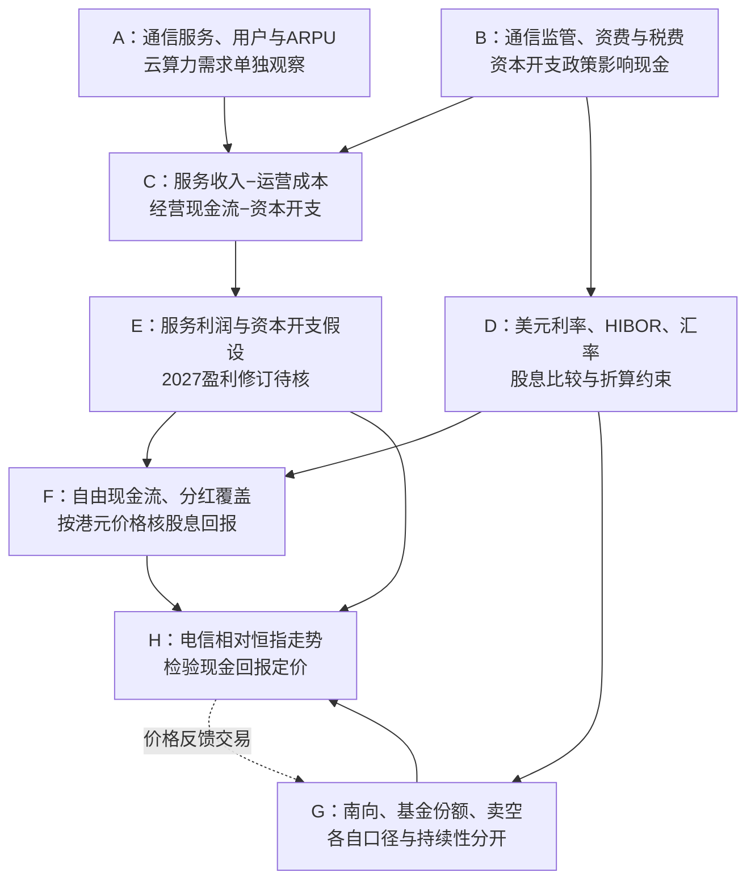

- **A**：移动/宽带服务与云算力需求分开；用户数增长可能被ARPU或价格变化抵消。
- **B**：通信监管及税费、资本开支政策影响盈利，算力投入也会消耗现金。
- **C**：服务收入−运营成本形成利润；经营现金流再减资本开支后检验股息覆盖。
- **D**：引用港股D：美元政策、HIBOR及风险溢价共同约束估值；人民币经营现金流须按净敞口解释港元折算。
- **E**：固定目标年度2027，比较可比机构样本的30/90日EPS修订。本轮未取得板块完整序列；实际收入、利润增长只记C，不冒充E。
- **F**：采用实际分红和可持续自由现金流收益率；未更新港元现价不填精确股息率。
- **G**：南向成交、基金真实份额及卖空/淡仓分开；未取得该板块完整境外净流量，不用市场总量代替。
- **H**：与恒指同窗比较20/60日表现；本轮未构造这组映射股票的合成指数，不能把几家公司均涨写成行业趋势。

**证据与反证**

- 2026前三季度：中国移动收入7803亿元，同比−1.8%；归母利润1062亿元，同比−7.9%。 [来源](https://www1.hkexnews.hk/listedco/listconews/sehk/2026/1020/2026102000963.pdf)
- 2026H1：中国电信中期分红总额约146.96亿元，相当于归母利润75%；派息比例不是现金覆盖率。 [来源](https://www.chinatelecom-h.com/en/ir/report/interim2026.pdf)

**龙头与细分标杆观察**

| 公司 | 观察身份及理由 | 跟踪动向 |
|---|---|---|
| 中国移动 00941 | 电信运营商龙头：用户与服务业务提供需求样本，资本开支和现金流检验分红。 | A/C/F：服务收入、资本开支、自由现金流与分红 |
| 中国电信 00728 | 电信运营商龙头：从云网服务、资本开支与分红交叉验证运营商现金回报。 | A/C/F：分红率、云业务盈利与现金流 |

保持/升级：利润压力可控且自由现金流覆盖分红，保留防守方向。

降级/失效：分红持续依赖负债/现金消耗，或服务盈利继续下降，则降级。

跟踪：季度看服务收入、资本开支与自由现金流；分红公告核派息与币种。

### 能源生产 · 主要方向

保留油气盈利弹性与煤炭现金回报两个子方向；商品高价和高股息不能互相替代。

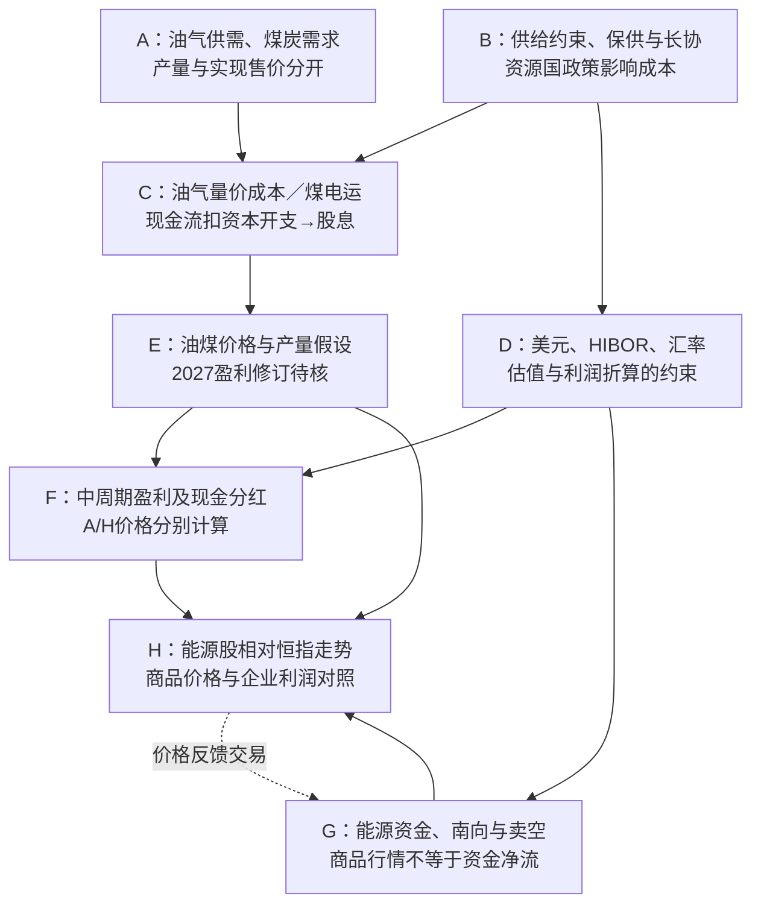

- **A**：油气库存和供给恢复决定价格；煤炭另看电力需求、库存和长协，不由布油替代。
- **B**：资源开发、保供和长协政策影响现金实现；海外项目也有资源国风险。
- **C**：油气看净产量、实现价和桶油成本；煤炭看销量/成本与煤电运利润结构。
- **D**：引用港股D：美元政策、HIBOR及风险溢价共同约束估值；人民币经营现金流须按净敞口解释港元折算。
- **E**：固定目标年度2027，比较可比机构样本的30/90日EPS修订。本轮未取得板块完整序列；实际收入、利润增长只记C，不冒充E。
- **F**：压力测试中周期价格后的现金回报；港元股价和人民币利润折算同口径。
- **G**：南向成交、基金真实份额及卖空/淡仓分开；未取得该板块完整境外净流量，不用市场总量代替。
- **H**：与恒指同窗比较20/60日表现；本轮未构造这组映射股票的合成指数，不能把几家公司均涨写成行业趋势。

**证据与反证**

- 2026前三季度：中海油净产量同比+2.7%、油气销售收入+19.5%、归母利润+16.8%；收入增幅高于产量，体现价格贡献。 [来源](https://www.cnoocltd.com/english/investorrelations/resultspresentations/results/202610/P020261030603688585622.pdf)
- 2026H1：中国神华具有煤电运一体化及并表变化，H股与A股经营依据相同，价格和股息率需分别计算。 [来源](https://static.cninfo.com.cn/finalpage/2026-08-29/1225531759.PDF)

**龙头与细分标杆观察**

| 公司 | 观察身份及理由 | 跟踪动向 |
|---|---|---|
| 中国海洋石油 00883 | 上游油气龙头：直接观察油气产量、实现价、桶油成本与开发资本开支。 | A/C/F：实现油价、产量、桶油成本及资本开支 |
| 中国神华 01088 | 煤电运一体化龙头：用一体化经营观察煤价波动能否转化为稳定现金与分红。 | A/C/F：同一经营数据、港元价格、汇率与股息口径 |

保持/升级：产量和成本优势支撑现金回报，继续主线。

降级/失效：价格下行叠加成本/资本开支上升导致现金回报明显恶化时下调。

跟踪：月度跟油价、供给恢复及煤炭经营数据；季度核成本、资本开支与派息。

### 油运 · 主要方向

维持油运盈利弹性方向；对应中远海能，重点看油轮运价、有效船天与实际利润。

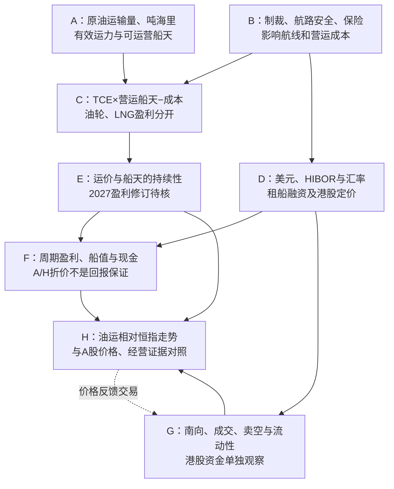

- **A**：运输量、吨海里及有效运力共同影响盈利，海峡关闭并非单向利好。
- **B**：航线合规、保险及制裁影响成本与船舶可运营性。
- **C**：同航线TCE×有效营运船天并考虑收入确认时滞；LNG贡献另列。
- **D**：引用港股D：美元政策、HIBOR及风险溢价共同约束估值；人民币经营现金流须按净敞口解释港元折算。
- **E**：固定目标年度2027，比较可比机构样本的30/90日EPS修订。本轮未取得板块完整序列；实际收入、利润增长只记C，不冒充E。
- **F**：A/H是同一经营资产，港元价格和流动性不同；A/H折价不能单独证明回报优势。
- **G**：南向成交、基金真实份额及卖空/淡仓分开；未取得该板块完整境外净流量，不用市场总量代替。
- **H**：与恒指同窗比较20/60日表现；本轮未构造这组映射股票的合成指数，不能把几家公司均涨写成行业趋势。

**证据与反证**

- 2026H1：中远海能报告同时覆盖原油、成品油和LNG，需拆分盈利。 [来源](https://static.cninfo.com.cn/finalpage/2026-08-29/1225525952.PDF)
- 2026-11-10：EIA给出运输受限及后续供给恢复两种作用方向，不能预设高运价持续整个半年。 [来源](https://www.eia.gov/outlooks/steo/report/)

**龙头与细分标杆观察**

| 公司 | 观察身份及理由 | 跟踪动向 |
|---|---|---|
| 中远海能 01138 | 油轮运输龙头：油轮业务直接连接吨海里、有效运力、运价和分部盈利。 | A/B/C：运价、有效船天；再分别看港股估值和流动性 |

保持/升级：运价与货量共振并在报表兑现时维持。

降级/失效：运价连续走弱、船舶无法营运或成本吞噬增益时降级。

跟踪：周度看同航线运价，季度核可运营船天及实际收益；港股流动性独立观察。

### 互联网平台与软件服务 · 条件看好

条件看好云、广告等经营改善，但必须由利润和现金回报确认；不把AI支出本身当成利好。

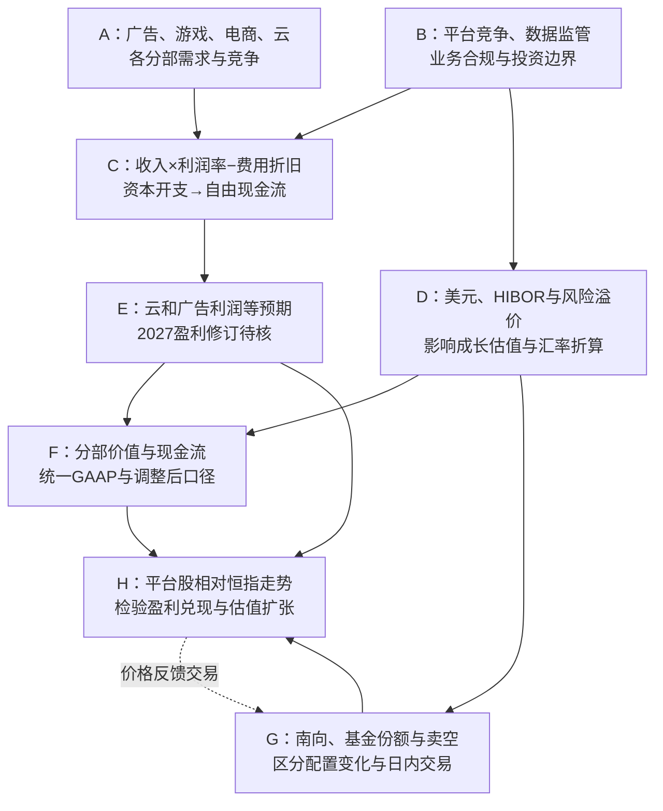

- **A**：广告、游戏、电商及企业云分别看需求；信息服务行业景气只提供背景。
- **B**：数据、平台竞争及业务监管按具体业务核；政策支持算力并不保证平台投资回报。
- **C**：分部收入×利润率，扣获客补贴、研发和折旧；资本开支与自由现金流是关键。
- **D**：引用港股D：美元政策、HIBOR及风险溢价共同约束估值；人民币经营现金流须按净敞口解释港元折算。
- **E**：固定目标年度2027，比较可比机构样本的30/90日EPS修订。本轮未取得板块完整序列；实际收入、利润增长只记C，不冒充E。
- **F**：分业务估值并统一GAAP/non-GAAP口径；高增长云不能直接抬高整个集团倍数。
- **G**：南向成交、基金真实份额及卖空/淡仓分开；未取得该板块完整境外净流量，不用市场总量代替。
- **H**：与恒指同窗比较20/60日表现；本轮未构造这组映射股票的合成指数，不能把几家公司均涨写成行业趋势。

**证据与反证**

- 2026Q2：腾讯官方业绩材料提供分业务及现金流口径；代表公司样本不等于整个港股互联网行业。 [来源](https://www.tencent.com/wp-content/uploads/2026/08/Tencent-Announces-2026-Second-Quarter-Results.pdf)
- 当前资料入口：阿里官方财报入口按财年披露，不能将FY2027Q1误标为2027自然年数据。 [来源](https://www.alibabagroup.com/en-US/ir-financial-reports-financial-results)

**龙头与细分标杆观察**

| 公司 | 观察身份及理由 | 跟踪动向 |
|---|---|---|
| 腾讯控股 00700 | 互联网平台龙头：用游戏、广告及企业服务利润检验投入是否形成现金回报。 | A/C/F：分业务盈利、资本开支和自由现金流 |
| 阿里巴巴 09988 | 电商与云平台龙头：观察云需求、电商竞争、资本开支和分部利润的取舍。 | A/C/E：云增长、竞争投入、利润和现金回报 |

保持/升级：经营利润与自由现金流改善，且估值未透支时升级。

降级/失效：收入增但利润与自由现金流持续转差，竞争投入吞噬增长时降级。

跟踪：季度核云/广告收入、分部利润、资本开支及自由现金流；固定2027预测。

### 半导体及算力相关硬件 · 条件看好

条件看好晶圆制造与算力硬件，但制造看利用率和折旧，整机看毛利与回款，不能合用一套估值。

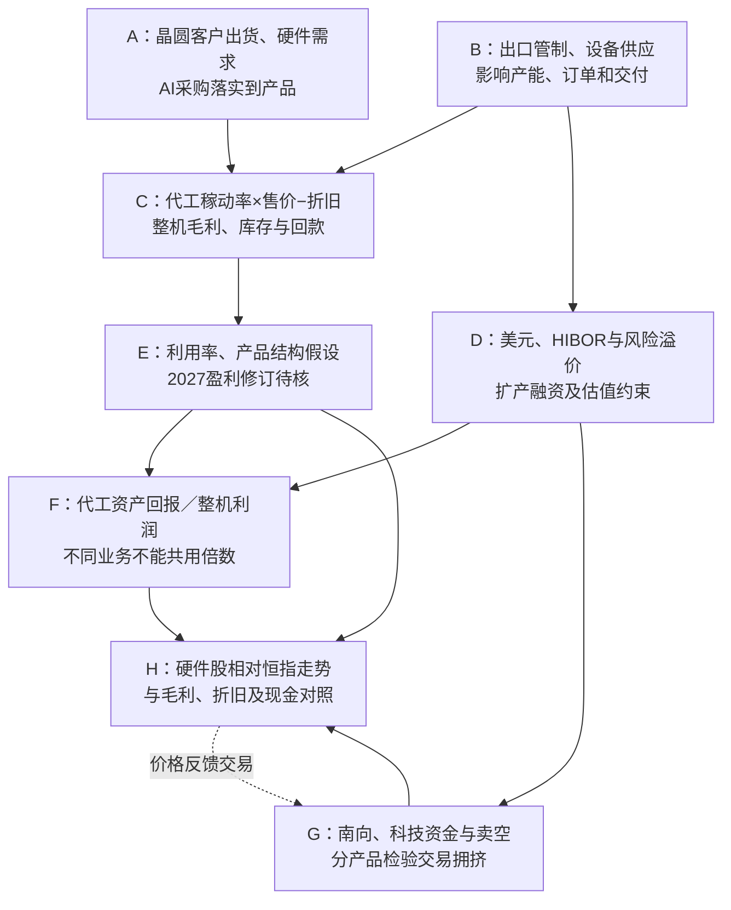

- **A**：代工客户出货与设备需求不同；AI配套芯片不等于高端AI处理器本身。
- **B**：出口管制与设备供应影响产能，国内投资支持须映射具体产品。
- **C**：晶圆代工看售价、稼动率与折旧；联想等整机看分部盈利及库存应收。
- **D**：引用港股D：美元政策、HIBOR及风险溢价共同约束估值；人民币经营现金流须按净敞口解释港元折算。
- **E**：固定目标年度2027，比较可比机构样本的30/90日EPS修订。本轮未取得板块完整序列；实际收入、利润增长只记C，不冒充E。
- **F**：代工用ROE/资产回报与PB、利润周期共同看；硬件按正常毛利及现金转化估值。
- **G**：南向成交、基金真实份额及卖空/淡仓分开；未取得该板块完整境外净流量，不用市场总量代替。
- **H**：与恒指同窗比较20/60日表现；本轮未构造这组映射股票的合成指数，不能把几家公司均涨写成行业趋势。

**证据与反证**

- 2026Q2：交易所转载报道指出中芯二季度增长，但本轮未据此使用其尚未逐项核实的三季报数值。 [来源](https://english.sse.com.cn/news/newsrelease/voice/c/c_20260818_10829265.shtml)
- 2026Q2：华虹官方披露目录列有二季度业绩，当前按特色工艺代工业务映射。 [来源](https://www1.hkexnews.hk/search/titlesearch.xhtml?category=0&market=SEHK&stockId=112822)
- FY2026/27 Q1：联想集团收入同比+43%、调整后净利润+176%；属集团、非HKFRS调整后口径，不等于纯算力业务增速。 [来源](https://investor.lenovo.com/en/financial/results/press_2627_q1.pdf)

**龙头与细分标杆观察**

| 公司 | 观察身份及理由 | 跟踪动向 |
|---|---|---|
| 中芯国际 00981 | 晶圆代工龙头：观察代工需求、利用率、售价与扩产折旧的共同变化。 | A/B/C：利用率、平均售价、折旧和毛利率 |
| 华虹半导体／HUA HONG GRACE 01347 | 特色工艺代工标杆：与中芯交叉观察成熟及特色工艺需求和产能利用率。 | A/C/F：产能爬坡、售价、利用率和折旧 |
| 联想集团 00992 | 整机硬件龙头 · 算力业务标杆：基础设施业务用于观察服务器盈利；PC业务分开处理。 | A/C：ISG分部利润、应收与集团业务组合 |

保持/升级：实际盈利和现金改善、扩产回报可见时升级。

降级/失效：出货增长被折旧和成本抵消，或库存应收明显恶化时降级。

跟踪：季度核利用率、毛利指引、扩产折旧；整机核基础设施分部利润和现金回款。
